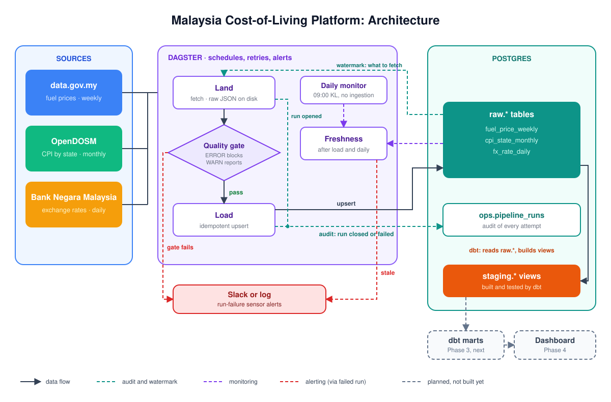
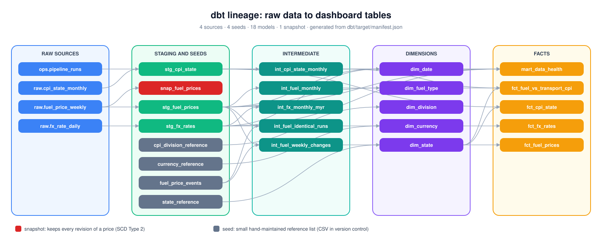

# 🇲🇾 Malaysia Cost-of-Living Data Platform


An end-to-end data platform that tracks Malaysian fuel prices, inflation and the ringgit,
built to answer one question: **how do pump prices flow through to the cost of living, and
which states feel it most?**

> **Status: Phase 3 of 4 complete.** Three public sources are ingested into Postgres on a
> schedule by Dagster, behind a blocking data-quality gate, with freshness monitoring and failure
> alerts (Phase 2). A dbt warehouse turns them into tested staging, intermediate and mart layers
> (17 models, 4 seeds, a snapshot, 195 tests including 6 unit tests), built in CI on every
> pull request (Phase 3). The dashboard is next. See the [roadmap](#roadmap).

## Architecture



## The sources

| Source | API | Lands in | Grain | Runs (KL time) |
|---|---|---|---|---|
| `fuel_prices` | data.gov.my `fuelprice` | `raw.fuel_price_weekly` | date, fuel type | Thu and Fri 10:00 |
| `cpi_state` | OpenDOSM `cpi_state` | `raw.cpi_state_monthly` | state, month, COICOP division | 14:30 on the 19th to 25th |
| `fx_rates` | BNM `/exchange-rate` | `raw.fx_rate_daily` | date, currency, BNM session | Mon to Fri 19:00 |

Each schedule follows its source's publishing rhythm; [DECISIONS.md](DECISIONS.md) #23 explains
each choice. Running a job more often than necessary is harmless, because every load is idempotent.

## How one run works

Every source runs the same three steps. The CLI chains them; Dagster runs them as separate,
observable steps. Both call the same functions in `col_pipeline.runner`.

1. **Land.** Call the API and write the untouched response to `data/landing/<dataset>/`. A row
   in `ops.pipeline_runs` records the attempt.
2. **Gate.** Transform the landed file and judge it. **ERROR** rules (columns, nulls, unique keys,
   plausible ranges, minimum volume, `buying <= selling`) block the load. **WARN** rules (a missing
   currency, an incomplete CPI month) are reported but never block.
3. **Load.** Stage-then-merge upsert. Unchanged rows are not rewritten, so `loaded_at` only moves
   when a value really changed. The run row is closed with exact inserted/updated counts.

After loading, a **freshness** check asks whether the source itself has stalled:

| Table | Newest date may be at most |
|---|---|
| `raw.fuel_price_weekly` | 10 days old |
| `raw.cpi_state_monthly` | 90 days old (month M is published around the 19th of M+1) |
| `raw.fx_rate_daily` | 5 days old (long weekend plus a holiday) |

A daily `quality_monitor_job` (09:00) runs the same checks even when no ingestion happened,
so a stopped schedule cannot hide a stale table.

## Run it

You need **Python 3.11+** and **Docker**. Every command is the same in PowerShell and bash.

```bash
python tasks.py setup              # creates .env and .venv (uses uv if installed)
# edit .env: change POSTGRES_PASSWORD (before the first `up`)
python tasks.py up                 # Postgres on localhost:5433
python tasks.py check              # config, connection, schema
python tasks.py probe-bnm          # see what the BNM API returns today (recommended first)
python tasks.py run                # load all three sources once
python tasks.py runs               # what happened
```

Then start the orchestrator:

```bash
python tasks.py materialize warehouse   # first time only: build the dbt warehouse (seeds, models)
python tasks.py dagster            # UI and scheduler at http://localhost:3000 (Ctrl+C stops)
```

The schedules and the failure sensor are switched on by default. Dagster keeps its state in
`dagster_home/`, so schedules survive a restart.

**Ingestion and the warehouse are one Dagster graph.** Every dbt model, seed and snapshot is a
Dagster asset, and every dbt test is an asset check. Each ingestion job lands, gates and loads its
source, then refreshes everything downstream of it in the same run: `fuel_prices_job` rebuilds
the fuel models, the dashboard mart and the price snapshot right after new prices arrive. A failing
dbt test fails the run and triggers the failure alert. (DECISIONS.md #51.)

| In this project (Dagster) | The Airflow equivalent |
|---|---|
| Job (`fuel_prices_job`) | DAG |
| Asset (`fuel_prices_raw`, `marts/fct_fuel_prices`) | Task, plus the dataset it produces |
| Blocking asset check (the quality gate) | A validation task the load depends on |
| Schedule (cron, Kuala Lumpur time) | DAG `schedule` |
| Run failure sensor (`alert_on_failure`) | `on_failure_callback` |
| Retry policy | Task `retries` and `retry_delay` |
| `dagster-dbt` (dbt models as assets) | Astronomer Cosmos |

Why Dagster rather than Airflow: DECISIONS.md #52.

### Upgrading from Phase 1

* Run `python tasks.py init-db` once. Docker only creates tables on a brand-new volume; this
  adds the two new tables to your existing database. It is safe to repeat.
* `LOOKBACK_DAYS` is gone from `.env`: each source now has its own lookback.
* New runs are logged under source names (`fuel_prices`, not `fuel_price_weekly`).

### All tasks

```
python tasks.py                       # lists everything
python tasks.py run fx_rates          # one source
python tasks.py run --since 2026-10-01   # backfill (idempotent: safe to repeat)
python tasks.py full-refresh cpi_state   # re-pull a source's full history
python tasks.py materialize fuel_prices  # run a Dagster job once (ingest + dbt downstream)
python tasks.py materialize warehouse    # build the whole dbt warehouse through Dagster
python tasks.py monitor               # freshness checks only; fails if anything is stale
python tasks.py validate              # can Dagster load every definition?
python tasks.py sources | init-db | check | probe-bnm
python tasks.py dbt-build             # dbt: install packages, build every model, run every test
python tasks.py dbt-freshness         # dbt: are the raw tables fresh enough?
python tasks.py dbt <any dbt command>   # e.g. dbt test -s stg_fx_rates, dbt docs generate
python tasks.py dbt-docs              # dbt docs site with the lineage graph, http://localhost:8080
python tasks.py lineage               # redraw docs/lineage.svg after changing models
python tasks.py load-sample           # SYNTHETIC data into an EMPTY database (CI, demos)
python tasks.py create-dashboard-role # the dashboard's read-only database login
python tasks.py dashboard             # the dashboard, http://localhost:8501
python tasks.py test | lint | fmt
python tasks.py psql | reset-db | down
```

### The dbt layer (Phase 3)

dbt reads the `raw` tables and builds everything downstream in its own schemas. `tasks.py` fills
in the connection from `.env`, so there is no `profiles.yml` to edit and no password to copy.

```bash
python tasks.py dbt-build          # first run installs dbt_utils, then builds and tests
python tasks.py dbt-freshness      # newest data date vs the limits in dbt/models/staging/_sources.yml
```

To try it without waiting for real data, use a **scratch** database and the synthetic sample
(it refuses to run if any raw table already holds rows, and labels every row
`source = 'synthetic-sample'`):

```bash
python tasks.py reset-db --yes && python tasks.py load-sample && python tasks.py dbt-build
```

See [dbt/README.md](dbt/README.md) for the layers and conventions.

### Lineage



This diagram is generated from dbt's own manifest (`python tasks.py lineage`), and CI fails a pull
request whose diagram no longer matches the models, so it cannot go stale. For the interactive
version with every model and column description, run `python tasks.py dbt-docs`. The same
descriptions are written into Postgres as comments, so they also appear in any SQL client.

### The dashboard (Phase 4, in progress)

A Streamlit app that answers the project question on its first page, with four supporting pages:

| Page | What it shows |
|---|---|
| **The answer** | RON95 price beside a state's transport CPI, month by month; transport CPI in the month after a fuel rise, fall or hold; a one-sentence finding computed from the data |
| **States** | States ranked for the latest published month; a state-by-month heatmap under the fuel changes; how much more each state's transport CPI rose after a fuel rise |
| **Fuel prices** | Weekly pump prices as steps, every change, reviewed events written on the chart |
| **Cost of living** | Transport beside the other 12 CPI divisions for a state, year on year |
| **About the data** | Rows, synthetic rows, date range and last load per source; method notes; open issues |

Partial months, months awaiting CPI, the national fuel price and synthetic data are labelled on the
charts themselves. It reads only the `marts` schema, connecting as `dashboard_reader`, a role that
can `SELECT` from `marts` and nothing else, so the database itself enforces that rule.
Set `DASHBOARD_DB_PASSWORD` in `.env` (see `.env.example`), then:

```bash
python tasks.py create-dashboard-role   # once, after dbt-build; again after a schema is dropped
python tasks.py dashboard               # http://localhost:8501
```

## Query the data

Everything lives in Postgres. Which tables exist depends on which commands you have run:

| Schema | Tables / views | Exists after |
|---|---|---|
| `raw` | `fuel_price_weekly`, `cpi_state_monthly`, `fx_rate_daily` | `up` (empty), then `run` fills them |
| `ops` | `pipeline_runs` (one row per load attempt) | `up` |
| `staging` | `stg_fuel_prices`, `stg_cpi_state`, `stg_fx_rates` (views) | `dbt-build` |
| `intermediate` | `int_fuel_monthly`, `int_fuel_weekly_changes`, `int_cpi_state_monthly`, `int_fx_monthly_myr` (views) | `dbt-build` |
| `reference` | `state_reference`, `cpi_division_reference`, `currency_reference`, `fuel_price_events` (dbt seeds) | `dbt-build` |
| `marts` | `dim_date`, `dim_state`, `dim_fuel_type`, `dim_division`, `dim_currency`, `fct_fuel_prices` (incremental), `fct_cpi_state`, `fct_fx_rates`, `fct_fuel_vs_transport_cpi`, `mart_data_health` (rows, synthetic rows and last load per source) | `dbt-build` |
| `snapshots` | `snap_fuel_prices`: every version of every fuel price, including revisions | `dbt-build` |

The dashboard question lives in one table: `marts.fct_fuel_vs_transport_cpi`, one row per state per
month. The fuel price is the national average weighted by the days each price was in effect, so
a month without an announcement still has a price. The current month is labelled
`fuel_month_status = 'partial'`; months whose CPI is not yet published are labelled
`cpi_status = 'awaiting_cpi'`. Reviewed events in the fuel series (for example the June 2024 diesel
change) are listed in `dbt/seeds/fuel_price_events.csv` and annotate `fct_fuel_prices`.
Run `python tasks.py check` any time to see what is missing.

**To get every table that exists today:**

```bash
python tasks.py up           # start Postgres
python tasks.py run          # fill the three raw tables (or `load-sample` on an empty scratch DB)
python tasks.py dbt-build    # create the staging views
python tasks.py psql         # open a SQL prompt
```

Then, in psql:

```sql
\dt raw.*                                  -- list tables in a schema (\dv staging.* for views)
select * from raw.fx_rate_daily order by 1 desc limit 10;
select * from staging.stg_fuel_prices limit 10;
select * from ops.pipeline_runs order by 1 desc limit 10;
\q                                         -- quit
```

Prefer a GUI (DBeaver, DataGrip, the VS Code Postgres extension)? Connect to `localhost:5433`
with the `POSTGRES_USER`, `POSTGRES_PASSWORD` and `POSTGRES_DB` from your `.env`.

### Alerts

Set `SLACK_WEBHOOK_URL` in `.env` to get a Slack message whenever a Dagster run fails: a blocked
quality gate, a stale table, or an API that stayed down after retries. Without it, alerts go to
the Dagster log. Treat the webhook URL as a secret.

### Without uv

`python tasks.py setup` notices uv is missing (or pass `--pip`) and uses `venv` plus `pip`. You
never need to activate the venv: `tasks.py` finds it. By hand:

| Step | Windows (PowerShell) | macOS / Linux |
|---|---|---|
| Create venv | `py -m venv .venv` | `python3 -m venv .venv` |
| Activate | `.venv\Scripts\Activate.ps1` | `source .venv/bin/activate` |
| Install | `python -m pip install -U pip` then `pip install -e . --group dev --group dbt` | same |
| Run | `col-pipeline run` | same |

### If something goes wrong

* `python tasks.py check` says whether it is configuration, a stopped Postgres, or missing tables.
* A BNM problem? `python tasks.py probe-bnm` saves BNM's exact responses to `data/probe/`.
* A run stuck at `running` in `runs`? The process died. The next run of that source closes it
  as abandoned after six hours.

## Proof it works

```bash
python tasks.py run && python tasks.py run && python tasks.py runs
```

The second run reports `0 inserted, 0 updated` for every source. The test suite proves the rest
against a real Postgres, on Python 3.11 to 3.13:

* **Idempotency** for all three sources, through the CLI and through Dagster.
* **The gate blocks**: a price of RM215 (sen instead of ringgit) or a CPI of 1324 loads nothing,
  not even the good rows, and the run is recorded as failed with the reason.
* **Retries are real and audited**: a flaky API succeeds on the third attempt, with two failed
  and one successful row in the run log. A failed gate is *not* retried: bad data cannot be fixed
  by trying again.
* **Real HTTP**: a local fake API server checks the headers and query strings that actually go
  over the wire, a genuine 503 followed by a retry, and a BNM holiday 404 during a backfill.

## Tests

```bash
python tasks.py test                    # unit tests, no database needed
```

Integration tests run when `TEST_DB_URL` points at a **disposable** database, because they
truncate tables. CI runs Linux on 3.11 to 3.13 with Postgres, Windows with uv, and the no-uv pip
path on both, and checks that Dagster loads every definition. A separate `dbt` job rebuilds the
whole chain on a throwaway database on every pull request (schema, synthetic data, `dbt build`
with every test, source freshness); the Windows job also checks that the dbt project parses.

## Known limitations

* **BNM's endpoints were confirmed by a live probe** on 2026-10-26: the latest-rates and
  per-date calls (`exchange-rate/USD/date/2026-10-26`) both return the documented envelope.
  Not yet checked live: the JPY quoting unit and a backfill across a public holiday.
* **Schedule times are reasoned, not confirmed.** See DECISIONS.md #23. The same probe showed
  BNM reporting `last_updated` at 23:01, after the 19:00 FX schedule; whether the 1700 rates are
  already available at 19:00 has not been checked.
* **The snapshot only sees what exists when dbt runs.** Dagster now runs it right after every fuel
  load (#51), so it sees every revision the pipeline loads. A revision the source publishes and
  corrects again between two pipeline runs is still never seen; that limit is upstream of us.
  Schedules only fire while `python tasks.py dagster` is running (#26).
* **Identical-price rule (DECISIONS.md #53):** on the current data it fails on the
  `diesel_eastmsia` series, which has matched peninsular `diesel` to the sen since 1 October 2026.
  The rule reports it and alerts; the dashboard mart still refreshes. It stays failing until the
  publisher corrects the figures, which is deliberate: the rule must not be silenced with an event.
  Before that rule, the full build passed on real data with no warnings (205 of 205).
  Phase 3 closes with this rule reporting three runs on real data, none of them reviewed. The
  reviews are deliberately not recorded: the publisher is not being contacted, and the three runs
  are left open for whoever maintains this project. Details in DECISIONS.md #53.
* **The identical-price review matches by start date only.** A reviewed run stays accepted if it
  grows, because only its first date is checked. A span-based review would close this; it is not
  built (DECISIONS.md #53).
* **A CPI state spelled differently** from `dbt/seeds/state_reference.csv` fails the build by
  design.
* **Dagster runs on the host** with `dagster dev`, not in a container. See #26.

## Design decisions

Every non-obvious choice is written down with its trade-off in [DECISIONS.md](DECISIONS.md):
Phase 1 (#1 to #7), the portability revision (#8 to #13), Phase 2 (#14 to #29) and the dbt
warehouse (#30 to #50) and its orchestration (#51 onwards).

## Roadmap

- [x] **Phase 1** Fuel prices to Postgres. Idempotent, incremental, logged, tested; runs on Linux and Windows, Python 3.11 to 3.13.
- [x] **Phase 2** CPI and exchange rates. Dagster schedules, retries, blocking quality gate, freshness monitoring, alerts.
- [x] **Phase 3** dbt staging, intermediate and marts; snapshots; docs; dbt in CI. Against the
  roadmap's Tier 3 criteria:
  - [x] 15 or more models across three layers: 17 (3 staging, 5 intermediate, 9 marts)
  - [x] Every column described and every model tested (enforced by `tests/test_dbt_project.py`)
  - [x] Incremental fact that never duplicates on re-run (`fct_fuel_prices`, re-run in CI)
  - [x] A snapshot keeping history of a changing source (`snap_fuel_prices`)
  - [x] `dbt build` in GitHub Actions on every pull request
  - [x] The grain of every fact stated in one sentence (in each model's description)
- [ ] **Phase 4** Dashboard, metrics, write-up.

## Data sources

* Fuel prices: [data.gov.my](https://data.gov.my/data-catalogue/fuelprice), CC BY 4.0.
* CPI by state: [OpenDOSM](https://open.dosm.gov.my/data-catalogue/cpi_state), CC BY 4.0.
* Exchange rates: [Bank Negara Malaysia Open API](https://api.bnm.gov.my); see BNM's terms of use.
