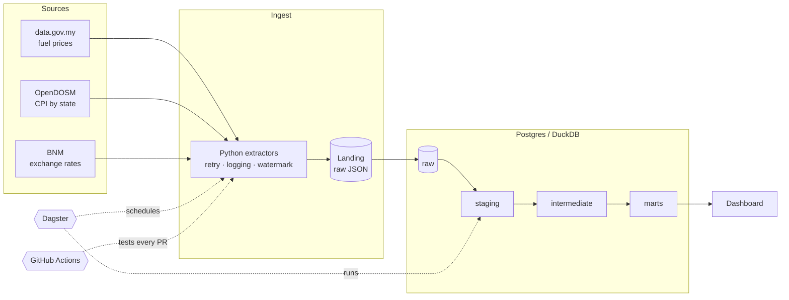
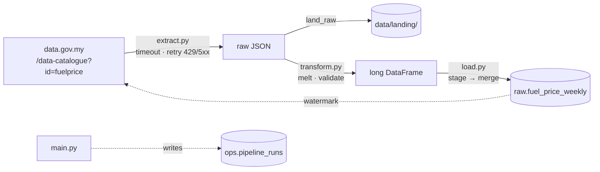

# 🇲🇾 Malaysia Cost-of-Living Data Platform

[](https://github.com/muhammadjauzi93/malaysia-cost-of-living-platform/actions/workflows/ci.yml)

An end-to-end data platform that tracks Malaysian fuel prices, inflation and the ringgit,
built to answer one question: **how do pump prices flow through to the cost of living, and
which states feel it most?**

> **Status: Phase 1 of 4.** Weekly fuel prices are ingested into Postgres with idempotent,
> incremental, logged and tested loads. See the [roadmap](#roadmap).

## Architecture (target)



## Phase 1: what runs today



| Module | Responsibility | Talks to |
|---|---|---|
| `extract.py` | Call the API, retry transient errors, return the payload untouched | HTTP only |
| `transform.py` | Wide → long, type, dedupe, enforce the data contract | Nothing (pure) |
| `load.py` | Idempotent upsert, watermark, run log | Postgres only |
| `main.py` | Wire the steps together, record the run, exit non-zero on failure | All of the above |
| `cli.py` | The `col-pipeline` command: `run`, `runs`, `check` | Calls the above |

## Run it

You need **Python 3.11 or newer** and **Docker**. Every command below is the same in
PowerShell, cmd, bash and zsh.

### Recommended: with uv

[Install uv](https://docs.astral.sh/uv/getting-started/installation/), then:

```bash
python tasks.py setup              # creates .env and .venv (runs `uv sync`)
# edit .env: change POSTGRES_PASSWORD
python tasks.py up                 # Postgres on localhost:5433, schema auto-created
python tasks.py check              # confirms config, connection and schema
python tasks.py full-refresh       # first load: full history since 2017
python tasks.py runs               # see what happened
```

After setup you can also call the CLI directly: `uv run col-pipeline run`.

### Without uv

Same commands. `setup` notices uv is missing (or pass `--pip`) and uses the standard
library's `venv` plus `pip` instead. You never need to activate the venv: `tasks.py` finds it.

If you prefer doing it by hand:

| Step | Windows (PowerShell) | macOS / Linux |
|---|---|---|
| Create venv | `py -m venv .venv` | `python3 -m venv .venv` |
| Activate | `.venv\Scripts\Activate.ps1` | `source .venv/bin/activate` |
| Install | `python -m pip install -U pip` then `pip install -e . --group dev` | same |
| Run | `col-pipeline run --full-refresh` | same |

(`--group` needs pip 25.1 or newer, hence the upgrade first.)

### All tasks

```
python tasks.py              # lists everything
python tasks.py run          # incremental load
python tasks.py test -k transform   # extra args go to pytest
python tasks.py lint | fmt   # check / fix code style
python tasks.py psql         # psql inside the container
python tasks.py reset-db     # wipe the DB volume and re-create the schema
python tasks.py down         # stop Postgres, keep data
```

### If something goes wrong

Run `python tasks.py check` first. It tells you whether the problem is configuration, a
Postgres that isn't running, or a missing schema, and what to try next.

## Proof it is idempotent

```bash
python tasks.py full-refresh
python tasks.py full-refresh
python tasks.py runs
```

The second run reports `0 inserted, 0 updated`. The same guarantee is tested against a real
Postgres in CI on Python 3.11, 3.12 and 3.13 (`tests/integration/test_load_idempotency.py`).

## Tests

```bash
python tasks.py test                         # unit tests, no database needed
```

Integration tests run when `TEST_DB_URL` points at a **disposable** database, because they
truncate tables. CI covers Linux (3.11 to 3.13, with Postgres), Windows (uv), and the
no-uv pip path on both.

## Design decisions

Every non-obvious choice is written down with its trade-off in [DECISIONS.md](DECISIONS.md).
Highlights: long format to absorb new fuel types without schema changes, a 21-day lookback to
catch revised prices, stage-then-merge for exact run metrics, and a portability revision
(entries 8 to 13) after the first version only ran on Unix with Python 3.11.

## Roadmap

- [x] **Phase 1** Fuel prices → Postgres. Idempotent, incremental, logged, tested, CI on Linux and Windows, Python 3.11 to 3.13.
- [ ] **Phase 2** Add OpenDOSM CPI + BNM rates. Dagster schedules, retries, quality checks.
- [ ] **Phase 3** dbt staging → intermediate → marts, snapshots, docs, dbt in CI.
- [ ] **Phase 4** Dashboard, metrics, write-up.

## Data source

Fuel prices from [data.gov.my](https://data.gov.my/data-catalogue/fuelprice), licensed CC BY 4.0.
Unauthenticated API limit: 4 requests/minute.
