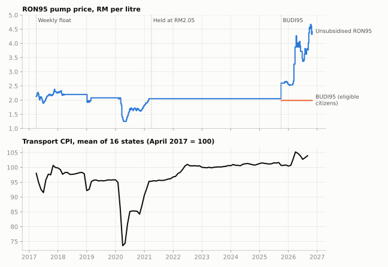
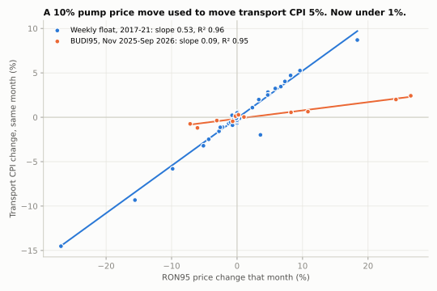
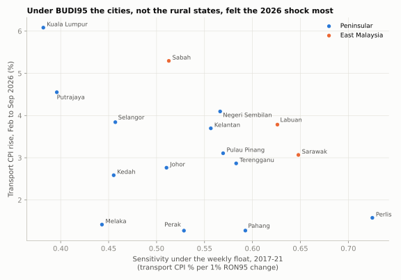

# How much of the pump price reaches the cost of living? Malaysia, 2017 to 2026

*Built on nine and a half years of real public data: weekly fuel prices from data.gov.my and
monthly state CPI from OpenDOSM. Data to September 2026 (CPI) and 29 October 2026 (fuel).*

## The short version

1. **When the pump price moves, transport costs move in the same month, and by about half as
   much.** Under the weekly float of 2017 to 2021, a 10% change in the RON95 price came with a
   5.3% change in transport CPI. That one number explains 96% of the month-to-month swings.
2. **Since September 2025, that link has been cut by more than 80%.** The unsubsidised RON95
   price rose 63% between February and September 2026. Transport CPI rose 3.2%. Under the
   old pass-through it would have risen roughly 30%.
3. **The shield is uneven.** Under the float, rural and Borneo states felt fuel prices most and
   Kuala Lumpur least. In the 2026 shock the order largely reversed: Kuala Lumpur, Sabah and
   Putrajaya saw the biggest transport rises, Perak, Pahang and Melaka the smallest.

## The question

Fuel is the most visible price in Malaysia. It is announced every week, it is political, and it
feeds into almost everything that moves. The question this project set out to answer is how a
change at the pump flows through to what households pay, and which states feel it most.

To answer it, the platform loads the weekly pump price for every fuel grade and the monthly
consumer price index (CPI) for 16 states across 13 spending categories, then lines them up month
by month. "Transport CPI" below is the price index for the transport category: fuel, but also
vehicles, servicing, fares and tolls. Because fuel is only part of that basket, a 10% fuel rise
should not move transport CPI by 10%. How far it does move is the *pass-through*.

## Three regimes in one chart



The RON95 price has been run three different ways in this period, which makes it a natural
experiment:

| Period | How RON95 was priced | What transport CPI did |
|---|---|---|
| Apr 2017 to Mar 2021 | **Weekly float**, tracking world oil | Followed the pump price closely, including the 2020 crash and rebound |
| Apr 2021 to Sep 2025 | **Held at RM2.05** for four and a half years | Crept up about 0.1% a month: the non-fuel part of transport |
| From 30 Sep 2025 | **BUDI95**: eligible citizens pay RM1.99; everyone else pays a floating price | Barely reacted to a 63% rise in the floating price |

## Finding 1: the pass-through is large, and it is immediate



Each dot is one month. Under the float (blue), the dots sit almost on a straight line with a
slope of 0.53: every 1% move in the RON95 price came with a 0.53% move in transport CPI. In
April 2020, as COVID-19 hit, RON95 fell 27% and transport CPI fell 14.5% in that same month.

The effect is also **immediate**. Once the same month's price change is accounted for, the
previous month's change adds nothing (its coefficient is 0.004). CPI is collected through the
month, so a weekly price change shows up in the month it happens.

This matters because the obvious way to look for a delay can mislead. Comparing *last month's*
fuel change with *this month's* CPI does show an effect: +1.24% after a rise against +0.01%
after a month with no change. But fuel changes come in runs. A rise was followed by another rise
11 times out of 20, so the "delayed" effect is mostly the next rise showing up. When a rise was
followed by a fall, transport CPI went *down* (−0.69% on average). The project's own dashboard
first made exactly this comparison; this analysis is why it now compares the same month and shows
what the previous month adds (DECISIONS.md #65).

## Finding 2: BUDI95 broke the link

On 30 September 2025 the single RON95 price became three: RM1.99 for eligible citizens
(BUDI95), RM2.05 under SKPS (the subsidised-petrol control system), and a floating unsubsidised price that
started at RM2.60. The published "RON95" price therefore jumped 26% in October 2025, yet
transport CPI *fell* 0.97% that month. The statistic follows what most households actually pay,
and for most of them the price had just dropped by 6 sen.

Then came the real test. From March 2026 world prices surged:

| Weekly price, RM per litre | February 2026 | 2026 peak | September 2026 |
|---|---|---|---|
| RON95, unsubsidised | 2.54 to 2.59 | 4.67 | 3.77 to 4.57 |
| RON95, BUDI95 | 1.99 | 1.99 | 1.99 |
| Diesel, Peninsular | 2.96 to 3.04 | 6.72 | 4.67 to 5.42 |

Between February and September 2026 the unsubsidised RON95 price rose 63%. Transport CPI
rose 3.2% and the overall CPI 1.0%. In the BUDI95 months the slope is 0.09 (the orange line),
about one sixth of what it was under the float. Applying the old slope to a 63% rise gives a
transport increase of roughly 30%. That is a straight-line extrapolation, so treat it as an order
of magnitude, but the gap between about 30% and 3% is the size of the shield.

The shock did not vanish entirely. Transport went from the ninth-fastest-rising of the 13 CPI
categories in September 2025 (+0.5% year on year) to the fourth in September 2026 (+2.3%, against
+1.6% for all items). Unsubsidised RON95, RON97 and fares all sit in the transport basket.
Food inflation, by contrast, *eased* (from +2.1% to +1.6%) even as Peninsular diesel peaked at
RM6.72. In the same period the subsidised diesel prices used by logistics fleets stayed at
RM2.10 to 2.15.

## Finding 3: who feels it has flipped



**Under the float**, every state followed fuel closely (most explain more than 95% of their
monthly variation with the fuel price alone), but not equally. A 1% fuel move came with 0.73%
in Perlis, 0.65% in Sarawak and 0.63% in Labuan, against 0.40% in Putrajaya and 0.38% in Kuala
Lumpur. That fits the usual picture: in rural states more of the transport basket is fuel for
private vehicles, while city residents spend more on fares, parking and services.

**In the 2026 shock** the most fuel-sensitive states of the past were not the ones hit hardest:

| Largest transport CPI rise, Feb to Sep 2026 | | Smallest | |
|---|---|---|---|
| Kuala Lumpur | +6.1% | Perak | +1.3% |
| Sabah | +5.3% | Pahang | +1.3% |
| Putrajaya | +4.6% | Melaka | +1.4% |
| Negeri Sembilan | +4.1% | Perlis | +1.6% |

The same three areas at the top also gained least when BUDI95 started: in October 2025 transport
CPI fell only 0.07% in Putrajaya, 0.26% in Sabah and 0.32% in Kuala Lumpur, against about 1.5% in
Labuan and Perak.

The data shows *that* this happened, not *why*. A plausible explanation is that a larger share of
fuel in these areas is bought at the unsubsidised price: non-citizens, who are not eligible for
BUDI95 and make up a large part of Sabah's and Kuala Lumpur's populations, and drivers of
RON97 cars, which are likely commoner in the capital. Testing that needs the transport index broken into
its items, which OpenDOSM does not publish by state. Across all 16 states the reversal is a
tendency, not a rule (rank correlation −0.31); it is clearest at the two ends.

## What to take from this

- **For households:** for eligible citizens the subsidy has done what it promised. A 63% rise
  in the market price of petrol showed up as a few percent on transport and about 1% on the
  overall cost of living.
- **For policy:** a targeted subsidy moves the burden rather than removing it. In the 2026
  shock it fell mainly on urban areas and Sabah. Any evaluation of BUDI95 should be made at
  state level, not only nationally.
- **For anyone reading the official "RON95" series:** since 30 September 2025 it is the
  unsubsidised price, not what most Malaysians pay. Analysis that treats it as continuous with
  the pre-2025 series will overstate fuel inflation badly.

## How it was built


Three public sources (data.gov.my fuel prices, OpenDOSM state CPI, Bank Negara exchange rates)
are loaded into Postgres on a schedule by Dagster. Each load passes a blocking quality gate:
a price of RM215, a sen value loaded as ringgit, stops the whole batch instead of reaching a
chart. dbt then builds tested staging, intermediate and mart layers (18 models, 207 tests) and
a snapshot that keeps every revision of every fuel price. A Streamlit dashboard reads only the
marts, through a database role that can do nothing else. Every non-obvious choice is written
down in [DECISIONS.md](../../DECISIONS.md).

Two engineering choices made this analysis possible:

- **A complete month-by-state grid.** The central table has a row for every state and month,
  even when a figure is missing, so "the previous month" always means the previous calendar
  month. A missing CPI month is labelled `awaiting_cpi`, never treated as zero.
- **Day-weighted monthly prices.** A price announced on the 25th counts for the days it was
  actually in force, not the whole month, so each month's fuel price matches the period the CPI
  collectors were pricing.

## Limits

- **National figures are a simple average of the 16 states**, not DOSM's weighted national
  CPI, which the platform does not load.
- **The BUDI95 period is short:** 11 months for the slope. The direction is clear; the exact
  0.09 is not precise.
- **Association, not a controlled experiment.** Other things changed in 2026 too. The
  tightness of the fit under the float, and the sharp change at a known date, make fuel the
  obvious driver, but nothing here isolates it formally.
- **Peninsular and East Malaysian diesel have had identical prices since 1 October 2026.** The
  platform's quality rules flag this as a possible publisher error. No finding above relies on
  it.

## Reproduce it

```bash
python tasks.py up && python tasks.py run && python tasks.py dbt-build
uv run --with matplotlib python docs/writeup/analysis.py
```

The script prints every number quoted here and redraws the three charts.
